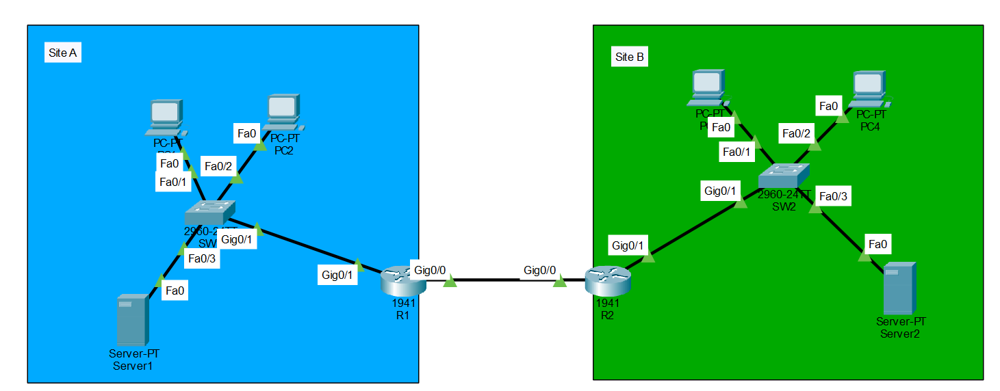
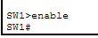
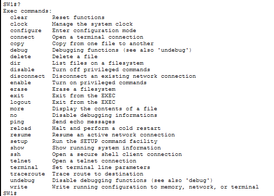
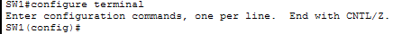
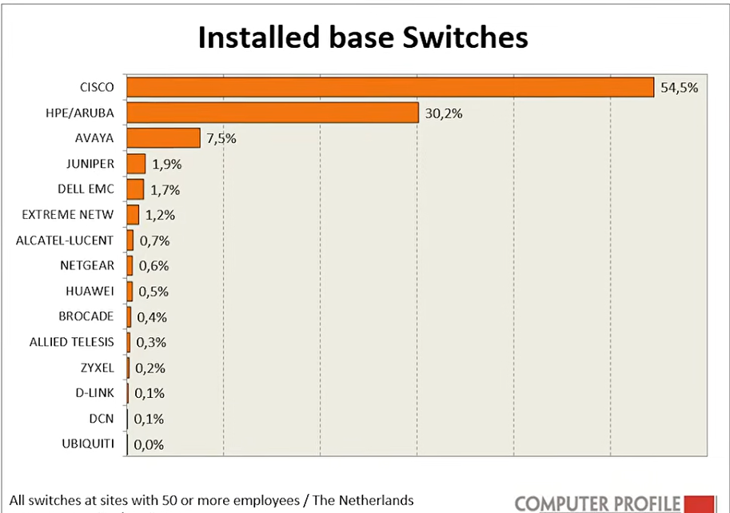
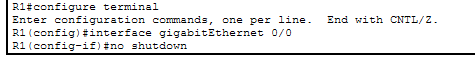
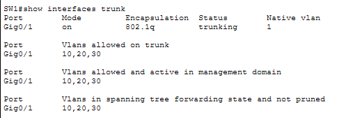
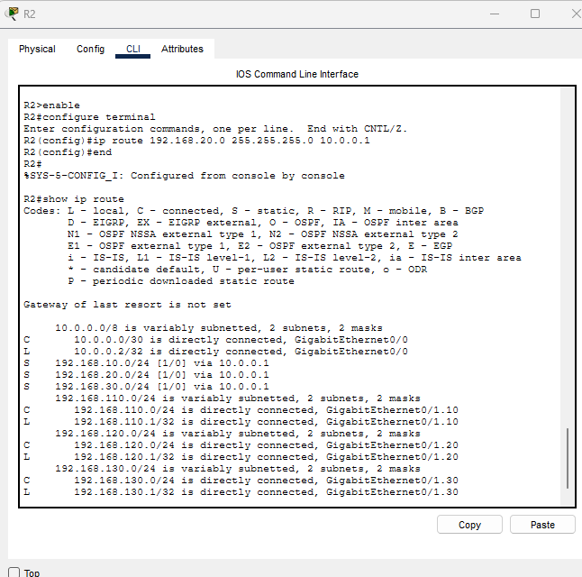
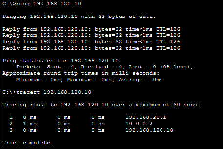

# Cisco Packet Tracer Branch Network Lab

Built and tested a two-site network using VLANs, 802.1Q trunks, router-on-a-stick, and static routes. Then worked through three controlled faults to practice finding where connectivity breaks and verifying the fix.

**Status:** baseline and three fault/recovery exercises verified through CLI screenshots. Corrected device configurations saved on SW1, SW2, R1, and R2, as confirmed during the lab. Full running-configuration exports have been reviewed and included. Built with Cisco Packet Tracer 9.0.1.0858. The saved-project reopen check passed: PC1 to PC3 returned 4/4 replies with 0% loss.

## What I worked on

- Assigned Sales, HR, and Management endpoints to VLANs 20, 30, and 10 at each site.
- Configured trunks and router subinterfaces to route between local VLANs.
- Connected the sites over a /30 WAN and added three static routes on each router.
- Checked gateway reachability, local and remote traffic, routing tables, and the actual packet path.
- Introduced and corrected an access-VLAN mismatch, a missing trunk VLAN, and a missing return route.

The starter topology is by PPechmann. My contribution is the configuration, testing, and documented troubleshooting. This is a Packet Tracer simulation; the screenshots show simulated results.

## Read the lab

- [Addressing and port map](docs/addressing-plan.md)
- [Verification results](docs/verification.md)
- [Troubleshooting cases](docs/troubleshooting.md)
- [Original staged plan](docs/lab-plan.md)

## Files

- `packet-tracer/branch-network-baseline.pkt`: saved baseline checkpoint.
- `packet-tracer/branch-network-troubleshooting.pkt`: completed fault-exercise project with corrected configuration and a successful saved-project connectivity retest.
- `packet-tracer/branch-network-working.pkt`: earlier working copy.
- `evidence/`: captured configuration, test, failure, and recovery screenshots.
- [`configs/`](configs/README.md): reviewed, actual running-config transcripts for all four devices, with a VLAN database rebuild note.
- `upstream/`: original starter, MIT license, and source manifest.

DHCP and ACLs were not implemented in this exercise. VLAN membership separates local broadcast domains; the routers currently allow the tested inter-VLAN traffic.

## Getting used to the Cisco CLI

Only Cisco would complicate the several layers of "EXEC modes," haha. But if you ever get lost, the question mark provides some commands.

Now we are gonna enter a new mode, "Configuration Mode." Why can't everything just be in this privileged mode? I don't know... There's also config-if mode and config-router mode and config-line mode. I don't know, you just have to deal with it. Because in the IT world, it feels like **EVERYONE USES CISCO...**

### Why learn Cisco?

*Chart credit: Computer Profile / Smart Profile, April 2018. Cisco accounted for 54.5% of the inventoried switches in this study of Dutch organizations with more than 50 employees. This is a historical Netherlands snapshot, not a current worldwide market-share figure. [Original research and context](https://smartprofile.io/analytics-papers/ciscos-share-in-networking-equipment-continues-to-decline/).*

Oh, and router configuration. Great, another new mode... To enable an interface, guess what? You'd think it would be `enable`. **NO! It's `no shutdown`.** I don't know what genius thought of that... but whatever, a green line is a good sign!

*The small CLI images above are supplied reference screenshots. The topology and test screenshots below are from my completed Packet Tracer lab.*

## Seeing it work

The green links were a good start. Then came checking the VLANs, routes, and actual traffic.

The trunk is forwarding all three VLANs between the switch and router.

R2 has the route back to Site A Sales again. That return path was the difference between a working local gateway and a failed cross-site ping.

Four replies, no packet loss, and the expected path through R1 and R2 to PC3. Full failure and recovery screenshots are linked in the [troubleshooting cases](docs/troubleshooting.md).

## Source and credit

[PPechmann Packet Tracer Practice Labs](https://github.com/PPechmann/Packet-Tracer-Practice-Labs). Copyright (c) 2025 PPechmann; original MIT license retained in `upstream/LICENSE`. The original solution file was not consulted.
