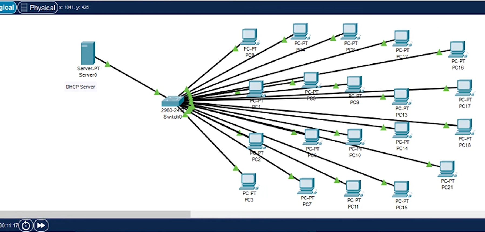
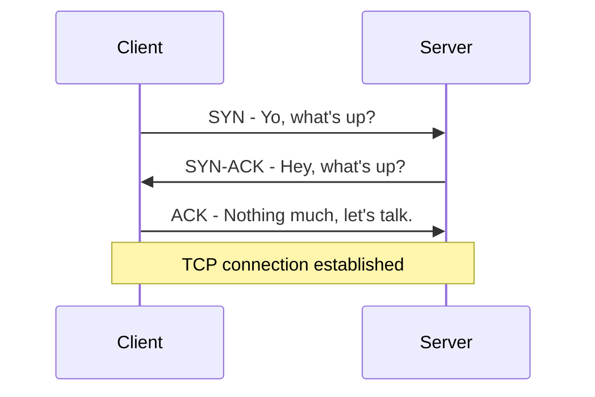
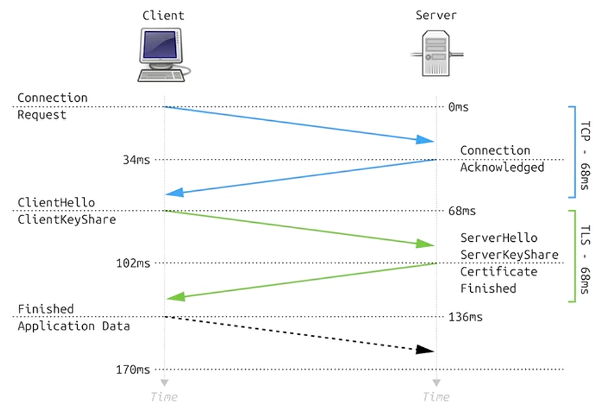
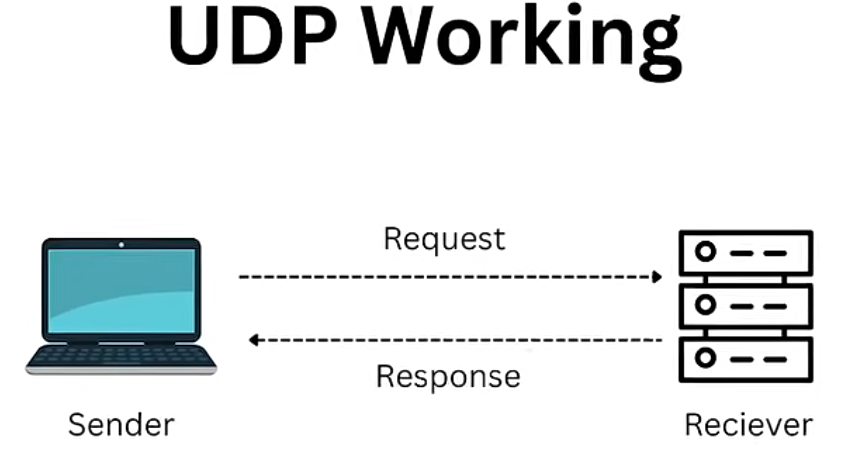

# Cisco Packet Tracer Branch Network Lab

Built and tested a two-site network using VLANs, 802.1Q trunks, router-on-a-stick, and static routes. Then worked through three controlled faults to practice finding where connectivity breaks and verifying the fix.

**Status:** baseline and three fault/recovery exercises verified through CLI screenshots. Corrected device configurations saved on SW1, SW2, R1, and R2, as confirmed during the lab. Full running-configuration exports have been reviewed and included. Built with Cisco Packet Tracer 9.0.1.0858. The saved-project reopen check passed: PC1 to PC3 returned 4/4 replies with 0% loss.

## What I worked on

- Assigned Sales, HR, and Management endpoints to VLANs 20, 30, and 10 at each site.
- Configured trunks and router subinterfaces to route between local VLANs.
- Connected the sites over a /30 WAN and added three static routes on each router.
- Checked gateway reachability, local and remote traffic, routing tables, and the actual packet path.
- Introduced and corrected an access-VLAN mismatch, a missing trunk VLAN, and a missing return route.

The starter topology is by PPechmann. My contribution is the configuration, testing, and documented troubleshooting. This is a Packet Tracer simulation; the screenshots show simulated results.

## Read the lab

- [Addressing and port map](docs/addressing-plan.md)
- [Verification results](docs/verification.md)
- [Troubleshooting cases](docs/troubleshooting.md)
- [Original staged plan](docs/lab-plan.md)

## Files

- `packet-tracer/branch-network-baseline.pkt`: saved baseline checkpoint.
- `packet-tracer/branch-network-troubleshooting.pkt`: completed fault-exercise project with corrected configuration and a successful saved-project connectivity retest.
- `packet-tracer/branch-network-working.pkt`: earlier working copy.
- `evidence/`: captured configuration, test, failure, and recovery screenshots.
- [`configs/`](configs/README.md): reviewed, actual running-config transcripts for all four devices, with a VLAN database rebuild note.
- `upstream/`: original starter, MIT license, and source manifest.

DHCP and ACLs were not implemented in this exercise. VLAN membership separates local broadcast domains; the routers currently allow the tested inter-VLAN traffic.

## Getting used to the Cisco CLI

Only Cisco would complicate the several layers of "EXEC modes," haha. But if you ever get lost, the question mark provides some commands.

Now we are gonna enter a new mode, "Configuration Mode." Why can't everything just be in this privileged mode? I don't know... There's also config-if mode and config-router mode and config-line mode. I don't know, you just have to deal with it. Because in the IT world, it feels like **EVERYONE USES CISCO...**

### Why learn Cisco?

*Chart credit: Computer Profile / Smart Profile, April 2018. Cisco accounted for 54.5% of the inventoried switches in this study of Dutch organizations with more than 50 employees. This is a historical Netherlands snapshot, not a current worldwide market-share figure. [Original research and context](https://smartprofile.io/analytics-papers/ciscos-share-in-networking-equipment-continues-to-decline/).*

Oh, and router configuration. Great, another new mode... To enable an interface, guess what? You'd think it would be `enable`. **NO! It's `no shutdown`.** I don't know what genius thought of that... but whatever, a green line is a good sign!

*The small CLI images above are supplied reference screenshots. The topology and test screenshots below are from my completed Packet Tracer lab.*

## Seeing it work

The green links were a good start. Then came checking the VLANs, routes, and actual traffic.

The trunk is forwarding all three VLANs between the switch and router.

R2 has the route back to Site A Sales again. That return path was the difference between a working local gateway and a failed cross-site ping.

Four replies, no packet loss, and the expected path through R1 and R2 to PC3. Full failure and recovery screenshots are linked in the [troubleshooting cases](docs/troubleshooting.md).

## Okay, but how did that actually work?

Congratulations, you made two computers communicate across two separate networks. You probably have a lot of questions about that... But that's good. It means you have a curiosity about stuff, and curiosity sparks the desire to learn.

Let's start with the basics. How did Computer A ping Computer B? What is a ping? How does Computer A decide where to send it?

### First, what is a ping?

A ping sends an **ICMP Echo Request**. If the destination receives it and responds, it sends an **ICMP Echo Reply** back. It's basically, "Yo, can you hear me?" followed by, "Yep, I'm here." It tests whether that ICMP traffic can make the round trip. It doesn't prove every app or service works.

### How does Computer A know where to send it?

In this lab, PC1 is `192.168.20.10/24`, and PC3 is `192.168.120.10/24`. PC1 uses its subnet mask to work out whether the destination is on its local network. PC3 isn't, so PC1 sends the traffic to its default gateway, `192.168.20.1`.

But Ethernet needs a **MAC address** for the next local hop. That's where **ARP — Address Resolution Protocol —** comes in. If PC1 doesn't already have the gateway's MAC address cached, the conversation is basically:

> PC1: "Yo, whose IP address is 192.168.20.1?"
>
> R1: "Yo, I'm 192.168.20.1. Here's my MAC address."
>
> PC1: "Thumbs up... lol."

That's the ARP exchange, not the ping itself. The request is broadcast within PC1's VLAN, and the gateway normally replies directly to PC1. ARP doesn't shout across both sites looking for PC3.

For a destination on the same subnet, PC1 would ARP for that destination directly instead of its gateway.

### Then the routers take over

PC1 puts the ping packet inside an Ethernet frame addressed to R1's MAC address. The packet's destination IP is still **PC3's IP**, not the gateway's.

1. SW1 carries the frame from PC1's access port over the VLAN 20 trunk to R1.
2. R1 checks its routing table. Its static route says to reach `192.168.120.0/24` through R2 at `10.0.0.2`.
3. R1 sends the packet in a new Ethernet frame toward R2, using ARP if it needs R2's MAC address.
4. R2 sees that PC3's subnet is directly connected through its VLAN 20 subinterface. It resolves PC3's MAC address if needed and forwards the packet through SW2.
5. PC3 receives the Echo Request and sends an Echo Reply back through its gateway. Both routers need the right routes for that reply to get back to PC1.

The IP source and destination stay the same on the request's journey in this lab because we aren't using NAT. Ethernet MAC addresses change at the router hops, and each router reduces the packet's **TTL — Time to Live**.

That also explains our missing-return-route exercise: the request had a way out, but the reply didn't have a route back. A green line alone couldn't tell us that.

The trace shows `192.168.20.1` -> `10.0.0.2` -> `192.168.120.10`. That's our two routers and the destination. Two computers talking, with quite a bit happening in between.

## Why are we manually assigning IP addresses like this?

Why do we do something so barbaric as manually configuring a static IP address?? We did that to understand how addresses, subnets, and gateways fit together, because it's important to know. But for everyday client devices, there's usually a less boring way.

Let me introduce you to **DHCP — Dynamic Host Configuration Protocol**. DHCP automates assigning IP addresses and other settings, like the subnet mask, default gateway, and DNS servers. That's why it's there: to do it for you. Static addresses still have their place for infrastructure, and DHCP reservations can give devices consistent addresses too.

Large organizations can use dedicated DHCP servers, like I've demonstrated in my [enterprise lab environment](https://github.com/kfisch94/enterprise-infrastructure-lab). For a typical initial IPv4 lease, remember **DORA**:

| Step | What's happening | Basically... |
| --- | --- | --- |
| Discover | Client looks for DHCP servers. | "Anyone got an address for me?" |
| Offer | A server offers an address and settings. | "You can use this one." |
| Request | Client requests the offered address and identifies its chosen server. | "Sure, I'll take that address." |
| Acknowledge | Server confirms the lease and settings. | "It's yours for this lease period." |

That's **Discover, Offer, Request, Acknowledge**. The address is leased, and the client normally renews it later. [DHCP protocol reference](https://www.rfc-editor.org/rfc/rfc2131).

*Reference illustration supplied for this explanation. DHCP wasn't added to the completed two-site branch lab; its tested endpoints use static IPv4 addresses.*

## Okay, which computer... and which program?

Now let me direct our small attention spans onto two main things: **getting traffic to the right computer, then getting it to the right application**.

| Field | What to keep in mind |
| --- | --- |
| Source MAC | Ethernet sender on the current link. |
| Destination MAC | Ethernet recipient on that link: the local destination or next-hop router. |
| Source IP | Where this IP packet came from. |
| Destination IP | Where this IP packet is headed. |

The MAC addresses change at router hops. The source and destination IP addresses stay the same in our branch lab because we aren't using NAT.

But when traffic reaches that computer, how does it know which program should receive it? This is where **TCP and UDP ports** come in. The operating system uses the transport protocol, addresses, and port numbers to associate traffic with a socket. A server might listen on TCP port 443, while the client uses a temporary source port so replies reach the right connection. Our earlier ICMP ping doesn't use TCP or UDP ports.

## TCP: "Yo, what's up?"

Understanding TCP means understanding the **three-way handshake**. Basically, the client goes to the server and says:

> Client, **SYN**: "Yo, what's up?"
>
> Server, **SYN-ACK**: "Hey, what's up?"
>
> Client, **ACK**: "Nothing much, let's talk."

Voila, the TCP connection is established. The handshake synchronizes sequence numbers; the dialogue is just my way of remembering it.

If data goes missing, TCP retransmits it, subject to timeouts and connection failure. If segments arrive out of order, TCP delivers a correctly ordered **byte stream** to the application. It doesn't have to wait for an entire file before delivering available, in-order bytes. [TCP protocol reference](https://www.rfc-editor.org/rfc/rfc9293).

### TCP isn't encryption

TCP itself isn't encrypted. With HTTPS over TCP, **TLS — Transport Layer Security —** sits above TCP to protect the application data in transit. Someone watching the network can't normally read that encrypted content, but the traffic isn't invisible: IP addresses, ports, timing, and packet sizes can still be visible. [TLS 1.3 reference](https://www.rfc-editor.org/rfc/rfc8446).

*Conceptual reference, not a capture or timing measurement from my lab. The TCP portion is condensed and doesn't draw all three handshake messages separately. Its millisecond values are illustrative.*

One wrinkle: HTTPS can also use HTTP/3 over QUIC, which runs over UDP. So HTTPS doesn't always mean TCP. [HTTP/3 reference](https://www.rfc-editor.org/rfc/rfc9114).

## UDP: send it and see

UDP, however, doesn't check whether the recipient is ready or even exists before sending. No TCP-style connection handshake. It's a minimal, connectionless transport: **UDP itself** doesn't guarantee delivery, ordering, or retransmission. An application can add those things if it needs them. [UDP protocol reference](https://www.rfc-editor.org/rfc/rfc768).

*A UDP application can send a response, as shown here. That response is application behavior, not a guaranteed UDP acknowledgment. UDP by itself doesn't encrypt the data either.*

## From banging rocks together to this

Obviously there's a bunch of stuff I didn't mention, like switching centers and deep-sea routing cables. I just want to know: how did we bang a couple of rocks together thousands of years ago and end up with this?? I have no idea. It's best not to think about it!

I've tried three Packet Tracer labs and completed one so far. Some of them are actually pretty hard, especially when you're on your own figuring out what broke. For this completed branch lab, I worked through the configuration and troubleshooting with guidance, then verified the results shown here.

I'd recommend trying one or two if you're getting into networking or network maintenance. Completing one properly, understanding the traffic, and explaining the fixes gave me more to talk about than just connecting devices until the lines went green.

The [PPechmann practice labs](https://github.com/PPechmann/Packet-Tracer-Practice-Labs) are where this project's starter topology came from. My completed example is documented above, with the working files, configs, and test results included.

## Source and credit

[PPechmann Packet Tracer Practice Labs](https://github.com/PPechmann/Packet-Tracer-Practice-Labs). Copyright (c) 2025 PPechmann; original MIT license retained in `upstream/LICENSE`. The original solution file was not consulted.
